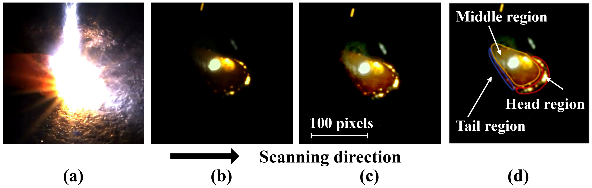
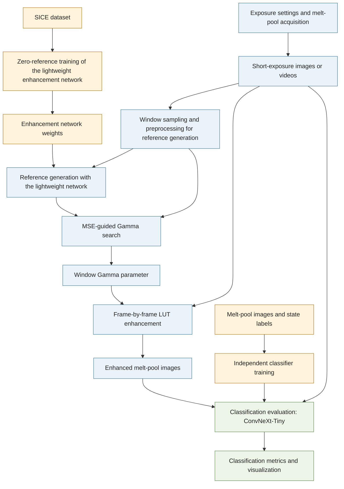

# DGA-Pool

**English** | [中文](README.zh.md)

A dual-stage melt-pool imaging strategy for laser-directed energy deposition based on exposure optimization and adaptive image enhancement.

This project provides the code and data accompanying **High-fidelity imaging of laser-directed energy deposition via a dual-stage strategy of exposure optimization and adaptive enhancement**, published in *Engineering Applications of Artificial Intelligence* 176 (2026), 114622.

[Paper](https://doi.org/10.1016/j.engappai.2026.114622) · [Dataset](#dataset) · [Quick start](#quick-start) · [Usage](docs/Usage.md)

## Overview

Melt-pool image quality is important for in-situ monitoring in laser additive manufacturing, but not every researcher has access to a monitoring platform with high-end imaging hardware. This project explores how an ordinary industrial camera can capture good-quality melt-pool images while avoiding overexposure and the loss of texture caused by the intense brightness of the melt pool. The approach first uses short exposure and a small aperture to reduce the light reaching the sensor, suppressing interference from substrate reflections, melt-pool radiation, plumes and spatter. An algorithm then restores the melt-pool image. This enhancement stage, called DGA-Pool, uses a dedicated lightweight enhancement network to generate an enhanced reference image, followed by adaptive Gamma search. When latency is less critical, the enhancement network can also be used directly to restore image detail and brightness.

- **Reference generation:** a lightweight enhancement network trained without reference targets, with only 5,215 parameters.
- **Adaptive enhancement:** network-generated references guide Gamma search and LUT processing at the original image resolution.
- **Classification evaluation:** a ConvNeXt-Tiny melt-pool classification task compares different image-processing schemes.

Image quality is a relatively abstract concept, so this project uses melt-pool classification accuracy to evaluate it. Enhancement and classification are two independent training pipelines. We thank [Zero-DCE](https://github.com/Li-Chongyi/Zero-DCE) for inspiring this project; our use of the SICE dataset also follows Zero-DCE.

## Imaging results

<p align="center">
  <br>
  <b>Melt-pool images before and after optimization: (a) automatic exposure; (b) short exposure and a small aperture; (c) DGA-Pool enhancement; (d) melt-pool regions identified from visual features.</b>
</p>

## Acquisition setup

Acquisition conditions set the upper limit on image quality. Improving these conditions and adjusting acquisition parameters should therefore take priority, as this usually offers a better return on effort than relying solely on post-processing algorithms. The equipment and imaging settings used in this project are listed below:

| Item | Model or setting |
|---|---|
| Laser | IPG Photonics YLR-1000 fiber laser, continuous wave, 1070 nm wavelength, maximum power 1 kW |
| Deposition nozzle | RC52, Zhongke Yuchen |
| Focused beam diameter | 0.6 mm |
| Camera | Hikvision MV-CA013-21UC color area-scan industrial camera |
| Lens | Hikvision MVL-HF0828M-6 MP |
| Camera position | Mounted beside the powder-feeding system and focused on the processing area; the camera optical axis is at 45° to the substrate |
| Lens aperture | F16, the smallest aperture opening available on this lens, to reduce incoming light |
| Exposure time | 65 μs, the camera's shortest supported exposure time and the setting used in the subsequent experiments in the paper |
| Acquisition frame rate | 90 fps |

The experiments used 304L stainless steel powder with particle sizes of 10–53 μm, a powder feed rate of 3.2 g/min and an argon flow rate of 13.6 L/min.

### Exposure optimization strategy

As described above, short exposure and a small aperture reduce the amount of incoming light, suppressing interference from substrate reflections, melt-pool radiation, plumes and spatter. However, exposure time cannot be shortened indefinitely: when it is too short, image information becomes difficult to recover. With the aperture fixed at F16, images captured at different exposure times are therefore compared using the following metrics to select a suitable exposure time.

| Metric | Calculation and purpose |
|---|---|
| Saturated Pixel Percentage (SPP) | Within the melt pool and its adjacent ROI, measure the percentage of pixels with grayscale values at or above 240 (on an 8-bit scale of 0–255) to assess information loss from overexposure |
| Contrast-to-Noise Ratio (CNR) | Apply Otsu's method to separate the melt pool from the background in each image, then divide the absolute difference between the two regional means by the square root of the sum of their variances to assess how well the melt pool can be distinguished from the background |
| Image Entropy (IE) | Calculate entropy from the grayscale distribution of the melt-pool region to assess the information retained in the image |
| Boundary gradients | Extract melt-pool boundary gradients using the Sobel operator and compare their mean magnitude and width to assess boundary sharpness and the effects of saturation blooming |
| Temporal segmentation stability | Calculate frame-to-frame intersection over union (IoU) and the coefficient of variation (CV) of melt-pool area across consecutive frames to assess segmentation fluctuations caused by plumes, spatter and other interference |

## Workflow



## Dataset

**Melt-pool imaging dataset:** 60 combinations of laser power and scanning speed, covering three states: over-melting, lack-of-fusion and normal melting.

| Content | Count | Download package |
|---|---:|---|
| Selected original melt-pool images | 13,157 | Image ZIP, approximately 386.9 MB, including ROIs |
| Melt-pool ROIs | 13,157 | Same image ZIP |
| Original AVI videos | 60 | Video ZIP, approximately 115.3 MB |

Download the [dataset](https://doi.org/10.5281/zenodo.24054469) from Zenodo. See Quick start below for extraction locations and the [data guide](data/README.md) for indices and split information.

## Quick start

### Download and place the data

The three-image example below does not require the full dataset. To use the full data, download the required ZIPs from the Zenodo link above and extract them into `data/` under the project root:

| Download package | Directory after extraction |
|---|---|
| `dual_stage_melt_pool_images.zip` | `data/dataset-images/` |
| `dual_stage_melt_pool_videos.zip` (optional) | `data/dataset-videos/` |

Each ZIP already contains its top-level directory. Do not create another directory with the same name and extract inside it. The code package contains only empty-directory placeholders; the two dataset packages also use separate directories, so no file merging or overwriting is needed.

```text
data/
├── examples/                   Examples supplied with the code
├── dataset-images/             After extracting the image package
│   ├── images/
│   │   ├── original/           Original images
│   │   └── roi/                ROI images
│   ├── metadata.csv
│   ├── videos.csv              Source index pointing to the sibling video directory
│   ├── splits/
│   ├── README.md
│   ├── LICENSE.txt
│   └── CITATION.cff
└── dataset-videos/             After extracting the video package
    ├── videos/
    ├── videos.csv
    ├── README.md
    ├── LICENSE.txt
    └── CITATION.cff
```

The video package is optional for image-only work. Each directory contains its own documentation, license and citation metadata.

### Install and run the examples

Use Python 3.11 or newer; Python 3.12 is recommended. Install [uv](https://docs.astral.sh/uv/getting-started/installation/), then run the following CPU installation commands in PowerShell from the project root:

```powershell
uv venv --python 3.12 .venv
uv pip install --python .venv/Scripts/python.exe -r requirements.txt --torch-backend cpu
```

The project includes three ready-to-use ROI images. No training or full dataset download is required:

```powershell
.\.venv\Scripts\python.exe -m scripts.enhance_images --input data/examples/images --output outputs/examples/enhanced --weights weights/enhancement_realtime.pth --device cpu
```

The output directory contains enhanced PNGs and per-image Gamma records. Replace `--input` with your own image or directory; keep the output directory outside the input directory.

## Video demo

The project includes a 19.56-second, 90-fps video assembled from normal-state clips:

```powershell
.\.venv\Scripts\python.exe -m scripts.enhance_video --source data/examples/videos/normal_video.mp4 --output outputs/examples/video_comparison.mp4 --weights weights/enhancement_realtime.pth --realtime --side-by-side --show --device cpu
```

Press Q or Esc, or close the window to stop. Omit `--show` for headless processing. Gamma starts at 1. The program collects images in four-second windows and estimates Gamma in the background. Parameters are updated when computation finishes; until then, the most recently available Gamma remains in use. Actual update timing depends on computation time.

## Repository structure

```text
src/             Enhancement, classification and ROI implementations
scripts/         Training, enhancement, evaluation and ROI entry points
configs/         Runtime and training configurations
data/examples/   Sample images, expected outputs and demonstration video
data/dataset-images/   Image dataset location (placeholder in the code package)
data/dataset-videos/   Video dataset location (placeholder in the code package)
weights/         Supplied enhancement checkpoint
docs/            Usage guides
```

See [usage](docs/Usage.md) for training, video windowing and the differences between the historical and paper configurations. All entry points support `--help`.

## Citation

If you use the method or code in your research, please cite:

```bibtex
@article{Li2026DualStageMeltPool,
  author = {Li, Jiazhen and Jiang, Xingyu and Liu, Ao and Liu, Shun and Tan, Qingze and Liu, Weijun and Tian, Zhiqiang},
  title = {High-fidelity imaging of laser-directed energy deposition via a dual-stage strategy of exposure optimization and adaptive enhancement},
  journal = {Engineering Applications of Artificial Intelligence},
  volume = {176},
  pages = {114622},
  year = {2026},
  doi = {10.1016/j.engappai.2026.114622},
  url = {https://doi.org/10.1016/j.engappai.2026.114622}
}
```

Machine-readable references: [software](CITATION.cff), `CITATION.cff` in the downloaded dataset and [BibTeX](references.bib).

## License and acknowledgements

Code, documentation, the supplied enhancement checkpoint and the dataset use [CC BY-NC 4.0](LICENSE.txt), permitting non-commercial use with attribution, a license link and an indication of changes.
