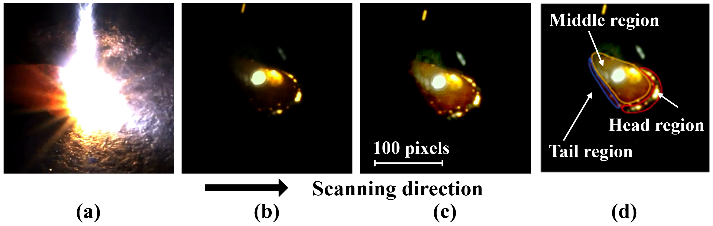
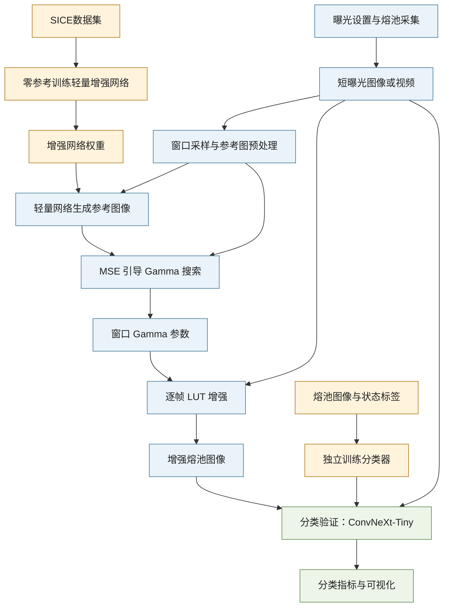

# DGA-Pool

[English](README.md) | **中文**

[](https://doi.org/10.5281/zenodo.24054469)

基于曝光优化与自适应图像增强的激光定向能量沉积两阶段熔池成像策略。 

本项目提供论文 **High-fidelity imaging of laser-directed energy deposition via a dual-stage strategy of exposure optimization and adaptive enhancement** 的配套代码与数据。论文发表于 *Engineering Applications of Artificial Intelligence* 176 (2026), 114622。

[论文](https://doi.org/10.1016/j.engappai.2026.114622) · [数据集](#数据集) · [快速开始](#快速开始) · [使用说明](docs/使用说明.md)

## 项目概览

熔池图像的质量是激光增材制造原位监测中的关键，但不是每个研究者都有条件使用硬件配置较好的监测平台采集高保真的熔池图像。本项目的出发点在于给出一种仅使用普通的工业相机就能采集到质量不错的熔池图像的思路，并在此过程中避免熔池过亮导致的相机过曝与熔池纹理缺失问题。项目的核心思路是，先基于低曝光、小光圈的策略，通过减少进光量，实现降低基板反光、熔池辐射、羽流和飞溅等一系列干扰的目的，之后再用算法恢复熔池本身的图像。这一增强流程被称为DGA-Pool算法，核心步骤是使用专用的轻量化增强网络生成熔池图像的增强参考图，再通过自适应Gamma搜索完成增强。如果对延迟不是很敏感，也可以直接基于增强网络恢复熔池图像细节与亮度。

- **参考生成**：采用零参考训练的轻量增强网络实现增强，仅含5215个参数。
- **自适应增强**：基于增强网络生成的参考图引导Gamma搜索与原尺寸LUT处理。
- **分类验证**：使用基于ConvNeXt-Tiny网络的熔池分类任务，比较不同图像处理方案。

图像质量是个相对抽象的概念，项目中使用熔池图像分类任务的准确率来评价图像质量。增强与分类是两条独立训练主干。感谢[Zero-DCE](https://github.com/Li-Chongyi/Zero-DCE)对本项目的启发，本项目对SICE数据集的使用参考了Zero-DCE。

## 成像效果

<p align="center">
  <br>
  <b>优化前后的熔池图像：(a) 自动曝光；(b) 低曝光与小光圈；(c) 基于DGA-Pool算法增强；(d) 根据视觉特征划分区域后的熔池。</b>
</p>

## 采集配置

采集环境决定成像质量的上限，应优先改善采集环境、调整采集参数，这通常比单纯依赖后期算法有更高的投入产出比。本项目使用的设备与成像参数如下：

| 项目 | 型号或设置 |
|---|---|
| 激光器 | IPG Photonics YLR-1000光纤激光器，连续波，波长1070 nm，最大功率1 kW |
| 打印喷嘴 | RC52，Zhongke Yuchen |
| 聚焦光斑直径 | 0.6 mm |
| 相机 | 海康威视MV-CA013-21UC彩色面阵工业相机 |
| 镜头 | 海康威视MVL-HF0828M-6 MP |
| 相机位置 | 安装在送粉系统旁，对准加工区域；相机光轴与基板夹角为45° |
| 镜头光圈 | F16，即该镜头的最小光圈开口，用于减少进光量 |
| 曝光时间 | 65 μs，为该相机支持的最短曝光时间，也是论文后续实验采用的设置 |
| 采集帧率 | 90 fps |

实验使用304L不锈钢粉末，粒径10–53 μm；送粉速率为3.2 g/min，氩气流量为13.6 L/min。

### 曝光优化策略

如前所述，本项目基于低曝光、小光圈的策略，通过减少进光量，实现降低基板反光、熔池辐射、羽流和飞溅等一系列干扰的目的。但曝光时间不能无限缩短，曝光时间过短会使图像信息难以恢复。因此，在将光圈固定为F16的条件下，采用以下指标对不同曝光时间下的图像进行对比，选择合适的曝光时间。

| 指标 | 计算方法与评价目的 |
|---|---|
| 饱和像素比例（SPP） | 在熔池及其邻近ROI内，统计灰度值达到或超过240的像素占比（8位图像灰度范围为0–255），判断过曝造成的信息损失 |
| 对比噪声比（CNR） | 对每张图像使用Otsu方法划分熔池与背景，以两区域均值差的绝对值除以两区域方差之和的平方根，评价熔池与背景的可区分程度 |
| 图像信息熵（IE） | 根据熔池区域的灰度分布计算信息熵，评价图像保留的信息量 |
| 边界梯度 | 使用Sobel算子提取熔池边界梯度，比较平均梯度幅值和梯度宽度，检查边界是否清晰、是否受到饱和扩散影响 |
| 分割时间稳定性 | 计算连续帧熔池区域的帧间交并比（IoU）和面积变异系数（CV），评价羽流、飞溅等干扰引起的分割波动 |

## 研究流程



## 数据集

**熔池成像数据集**：覆盖60组激光功率/扫描速度工况，包含过熔、欠熔与正常三类状态。

| 内容 | 数量 | 下载包 |
|---|---:|---|
| 筛选后的原始熔池图像 | 13,157张 | 图像ZIP约386.9 MB，包含ROI |
| 熔池ROI | 13,157张 | 同一图像ZIP |
| 原始AVI视频 | 60段 | 视频ZIP约115.3 MB |

可从Zenodo下载本项目所需的[数据集](https://doi.org/10.5281/zenodo.24054469)。下载与解压位置见下方“快速开始”，数据索引和划分说明见[数据说明](data/README.md)。

## 快速开始

### 下载与放置数据

运行下面的三张图样例不需要下载完整数据集。使用完整数据时，从上方Zenodo链接下载所需ZIP，并将它们解压到项目根目录的`data/`下：

| 下载包 | 解压后的目录 |
|---|---|
| `dual_stage_melt_pool_images.zip` | `data/dataset-images/` |
| `dual_stage_melt_pool_videos.zip`（可选） | `data/dataset-videos/` |

每个ZIP已带有对应的顶层目录，不要再手动创建同名目录后向里面解压。代码包只保留空目录占位，两个数据包也使用不同目录，不需要合并或覆盖文件。

```text
data/
├── examples/                   随代码提供的运行样例
├── dataset-images/             图像包解压后
│   ├── images/
│   │   ├── original/           原图
│   │   └── roi/                ROI
│   ├── metadata.csv
│   ├── videos.csv              指向旁边视频目录的来源索引
│   ├── splits/
│   ├── README.md
│   ├── LICENSE.txt
│   └── CITATION.cff
└── dataset-videos/             视频包解压后
    ├── videos/
    ├── videos.csv
    ├── README.md
    ├── LICENSE.txt
    └── CITATION.cff
```

只需要图像时，可以不下载视频包。两个目录各有自己的说明、许可和引用信息。

### 安装与运行样例

使用Python 3.11及以上，推荐Python 3.12。安装[uv](https://docs.astral.sh/uv/getting-started/installation/)后，从项目根目录在PowerShell中运行以下CPU安装命令：

```powershell
uv venv --python 3.12 .venv
uv pip install --python .venv/Scripts/python.exe -r requirements.txt --torch-backend cpu
```

项目中包含三张可直接使用的ROI图像，无需训练或下载完整数据集：

```powershell
.\.venv\Scripts\python.exe -m scripts.enhance_images --input data/examples/images --output outputs/examples/enhanced --weights weights/enhancement_realtime.pth --device cpu
```

输出目录包含增强PNG与逐图Gamma记录。将`--input`替换为自己的单图或图像目录即可；输出目录应位于输入目录之外。

## 视频演示

随附19.56秒、90fps的正常状态拼接视频：

```powershell
.\.venv\Scripts\python.exe -m scripts.enhance_video --source data/examples/videos/normal_video.mp4 --output outputs/examples/video_comparison.mp4 --weights weights/enhancement_realtime.pth --realtime --side-by-side --show --device cpu
```

按Q、Esc或关闭窗口结束。省略`--show`可无界面运行。初始Gamma为1。程序以4秒为一个窗口采集图像，并在后台估计Gamma；计算完成后更新参数，其间继续使用最近一次可用的Gamma。实际更新时间取决于计算耗时。

## 项目目录

```text
src/             增强、分类与ROI实现
scripts/         训练、增强、评估与ROI运行入口
configs/         运行和训练配置
data/examples/   样例图、预期结果与演示视频
data/dataset-images/   图像数据解压位置（代码包仅含占位文件）
data/dataset-videos/   视频数据解压位置（代码包仅含占位文件）
weights/         随附增强权重
docs/            使用说明
```

训练、视频窗口及历史/论文配置差别见[使用说明](docs/使用说明.md)。所有入口支持`--help`。

## 引用

研究中使用方法或代码时，请引用：

```bibtex
@article{Li2026DualStageMeltPool,
  author = {Li, Jiazhen and Jiang, Xingyu and Liu, Ao and Liu, Shun and Tan, Qingze and Liu, Weijun and Tian, Zhiqiang},
  title = {High-fidelity imaging of laser-directed energy deposition via a dual-stage strategy of exposure optimization and adaptive enhancement},
  journal = {Engineering Applications of Artificial Intelligence},
  volume = {176},
  pages = {114622},
  year = {2026},
  doi = {10.1016/j.engappai.2026.114622},
  url = {https://doi.org/10.1016/j.engappai.2026.114622}
}
```

机器可读引用见[软件CITATION.cff](CITATION.cff)、数据包内的`CITATION.cff`及[references.bib](references.bib)。

## 许可与致谢

代码、文档、随附增强权重与数据采用[CC BY-NC 4.0](LICENSE.txt)，允许非商业使用，须署名、提供许可链接并注明修改。